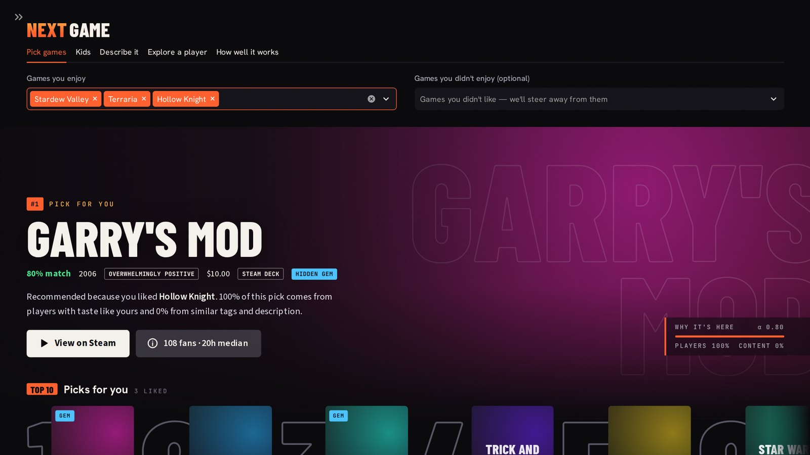
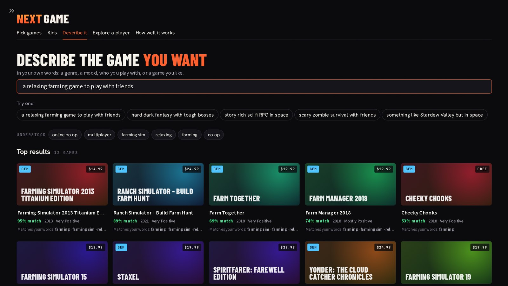
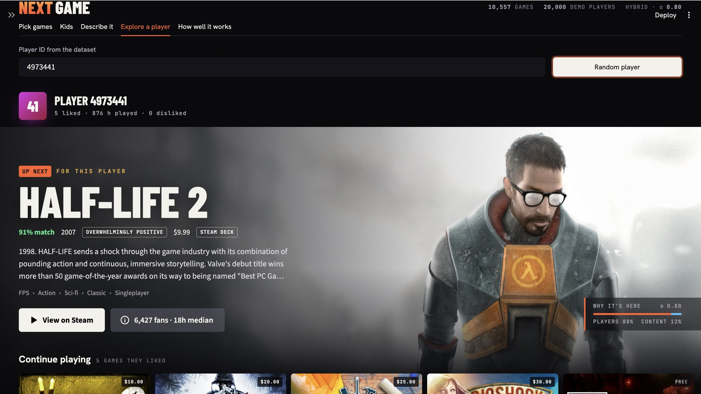
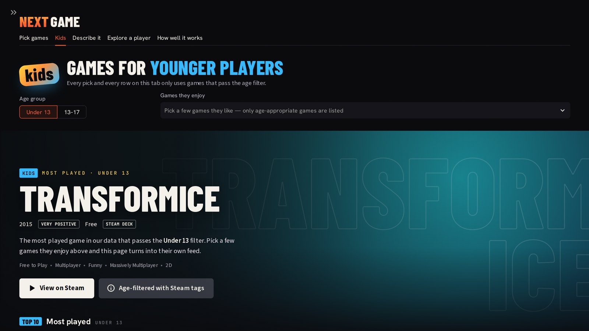
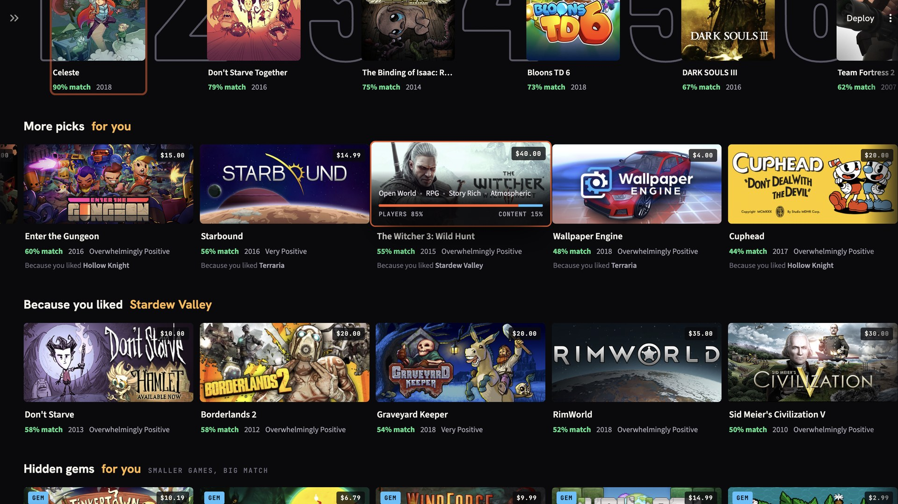

# Steam Game Recommender

A hybrid recommender system for Steam games. It combines **what similar players enjoy** (collaborative filtering) with **what the games are about** (content-based filtering), and serves the results in a Streamlit web app.

Semester 5 Machine Learning project by **Raghav Malhotra**, B.Tech CSE (AI & ML), Manipal University Jaipur.



## Features

- **Hybrid model**: item-kNN collaborative filtering + TF-IDF content model, blended 80/20 (α = 0.8, tuned on held-out data)
- **Pick games**: choose games you like (and dislike) and get a personal feed: a #1 pick, a Top 10 and rows such as "Because you liked X"
- **Describe it**: type what you want in plain English ("a relaxing farming game to play with friends")
- **Explore a player**: see a real dataset player's history next to their recommendations
- **Discovery controls**: avoid games like your dislikes, more variety (MMR re-ranking), hidden gems, and filters for price, year, rating and platform
- **Kids section**: age-appropriate games only (Under 13 / 13–17), from Steam tags, Steam's official age data and parent controls, plus a Kids lock for the whole app
- **Explanations**: every pick says why it was chosen and how much came from players vs content

## How it works

| Part | What it does |
|---|---|
| Content-based | TF-IDF over Steam tags and store descriptions, compared with cosine similarity |
| Collaborative filtering | Item-kNN: cosine similarity between games over the player × game matrix, with shrinkage and the top 50 neighbours |
| Hybrid | `score = α · CF + (1 − α) · Content`, each part min-max normalised per player, best α = 0.8 |

Likes are positive reviews, weighted by playtime as `1 + log(1 + hours)`.

## Results

Each player's liked games were split 80/20; the model had to find the hidden 20% in its top 10 (5,000 test players).

| Model | Precision@10 | Recall@10 | NDCG@10 | HitRate@10 | Coverage |
|---|---|---|---|---|---|
| Random | 0.0002 | 0.0009 | 0.0006 | 0.0024 | 0.9918 |
| Popularity | 0.0101 | 0.0498 | 0.0295 | 0.0944 | 0.0017 |
| Content-based | 0.0104 | 0.0533 | 0.0342 | 0.0968 | 0.3874 |
| Item-kNN CF | 0.0274 | 0.1360 | 0.0887 | 0.2320 | 0.1855 |
| **Hybrid (α = 0.8)** | **0.0281** | **0.1394** | **0.0906** | **0.2366** | 0.1924 |

- **Gap features** (change vs the plain hybrid): hidden gems +45.8% long-tail games for −0.8% NDCG; avoiding dislikes −19.9% disliked games shown for −3.4% NDCG; variety +4.7% diversity for −0.6% NDCG.
- **New games (cold start)**: on 500 games hidden from training, content-based scored NDCG 0.1426 vs 0.0105 for CF, about 14× better; giving new games a CF estimate from similar games raised it to 0.1477.

## Dataset

[Game Recommendations on Steam](https://www.kaggle.com/datasets/antonkozyriev/game-recommendations-on-steam) by Anton Kozyriev (Kaggle): about 41 million reviews and 50,872 games, up to October 2023. After cleaning: 2.15 million likes from 197,166 players on 10,557 games. Missing tags for big games were filled from the [SteamSpy API](https://steamspy.com/api.php).

The trained model (`steam_recommender_model.joblib`, 7.7 MB) is included, so the app runs straight away. The raw data is not included because it is large; the notebook downloads it.

## Run it

**1. Retrain (optional)** — the trained model is already in the repo. To rebuild it, open `steam_game_recommender.ipynb` in Google Colab and *Run all*. It downloads the data, trains, evaluates and saves `steam_recommender_model.joblib`.

**2. Start the app** — from the project folder:

```bash
python -m venv .venv
# Windows
.venv\Scripts\python -m pip install -r requirements.txt
.venv\Scripts\python -m streamlit run app.py
# Mac / Linux
.venv/bin/python -m pip install -r requirements.txt
.venv/bin/python -m streamlit run app.py
```

On Windows you can also double-click `start_app.bat`. The app opens at http://localhost:8501; game art loads from Steam's image CDN when you're online.

**3. Optional** — `python fetch_age_ratings.py` checks the 600 most-played games against Steam's official age data for the Kids section (about 15 minutes, can be resumed).

## Screenshots

| Describe it | Explore a player |
|---|---|
|  |  |

| Kids section | Rows and hover details |
|---|---|
|  |  |

## Project structure

```
├── steam_game_recommender.ipynb   # data cleaning, models, evaluation, model export
├── steam_recommender_model.joblib # trained model used by the app
├── app.py                         # Streamlit app
├── themes.py                      # app styling
├── fetch_age_ratings.py           # optional: Steam's official age data for the Kids section
├── start_app.bat                  # Windows one-click start
├── requirements.txt
├── .streamlit/config.toml         # dark theme
└── docs/screenshots/
```

## Limitations and future work

- α was tuned on the test players; a separate validation set would be cleaner.
- Random 80/20 split rather than a time-based one.
- Classic models (TF-IDF, item-kNN); matrix factorisation (ALS) or sentence embeddings are natural next steps.
- The Kids filter is a cautious estimate from tags, not an official rating.
- Data ends in October 2023.

## References

- A. Kozyriev, *Game Recommendations on Steam*, Kaggle dataset.
- B. Sarwar, G. Karypis, J. Konstan, J. Riedl, "Item-based collaborative filtering recommendation algorithms," WWW 2001.
- R. Burke, "Hybrid recommender systems: survey and experiments," *User Modeling and User-Adapted Interaction*, 2002.
- J. Carbonell, J. Goldstein, "The use of MMR, diversity-based reranking for reordering documents and producing summaries," SIGIR 1998.
- K. Järvelin, J. Kekäläinen, "Cumulated gain-based evaluation of IR techniques," *ACM TOIS*, 2002.
